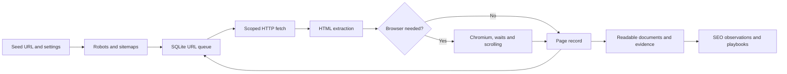

# How SeoForge works

SeoForge separates fetching, extraction and interpretation. Each stage keeps enough evidence to explain the next one.



## Source layout

| Path | Responsibility |
|---|---|
| `src/seoforge/cli/` | Commands, projects, onsite edits, publishing helpers |
| `src/seoforge/crawl/` | Config, HTTP transport, robots, crawler engine, render, doctor, watch |
| `src/seoforge/extract/` | HTML observations, markdown conversion, capture quality |
| `src/seoforge/analyze/` | Findings, access diagnostics, readiness and snapshot compare |
| `src/seoforge/research/` | Profiles, discovery adapters, deep research plans |
| `src/seoforge/reputation/` | Backlink verification and reputation scoring |
| `src/seoforge/report/` | Offline HTML/PDF presentation and brand assets |
| `playbooks/` | SEO / AEO / GEO methods, templates and industry guidance |
| `tests/` | Local HTTP/browser fixtures and regression cases |

HTTP workers fetch pages concurrently, with shared per-origin request spacing. Browser observations run sequentially in fresh contexts. The SQLite database stores configuration, discovered URLs, page records and sitemap membership. A run can recover its pending queue. Reports regenerate from stored records without fetching again.

## Python usage

```python
from seoforge import Config, Crawler

config = Config(
    url="https://example.com",
    max_pages=10,
    render_mode="auto",
    timeout=40,
)
crawler = Crawler(config, "runs/python-example")
try:
    summary = crawler.run()
    print(summary["html_documents"])
finally:
    crawler.close()
```

Use one `Crawler` per output directory and always close it. The CLI provides an output lock; direct library users must avoid concurrent writers to the same directory.

## Interpretation boundaries

A page observation establishes what this run received. It does not establish what a search engine indexed or what a user saw on a different device, geography, session or date. Read [measurement boundaries](../references/measurement-boundaries.md) before turning observations into business conclusions.
